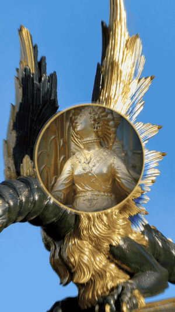

# longtake

**一镜到底的竖屏动效短片 Skill。** 给 Claude Code 等 Agent 用：一个 HTML 合成文件，每一帧都是时间的纯函数，逐帧渲染、带真实快门模糊，节奏跟着音乐的拍子走，专门为小红书、抖音、视频号的 9:16 竖屏做了调整。

**A one-take motion-film Skill, vertical-first.** One HTML composition where every frame is a pure function of time, rendered frame by frame with real shutter blur, cut to a music grid, and tuned for 9:16 short-video platforms.

> 基于 [onetake](https://github.com/feitangyuan/onetake)（作者 Patrick）修改。原作者署名、`LICENSE` 和 `NOTICE` 原样保留；改了什么见 [`CHANGES.md`](CHANGES.md)。
> Based on [onetake](https://github.com/feitangyuan/onetake) by Patrick. The original attribution, `LICENSE` and `NOTICE` are kept; what changed is in [`CHANGES.md`](CHANGES.md).

[](LICENSE)
[](SKILL.md)




<sub>示例：《画中洞天》，22.5 秒竖屏，一镜钻进 16 张图，每张图里的洞通向下一张，跟着配乐的鼓点走。Example: a 22.5 s vertical dive through 16 nested pictures on a music grid. → [`cases/huazhong-dongtian-22s`](cases/huazhong-dongtian-22s/)</sub>

[中文](#中文) · [English](#english)

---

## 中文

### 和 onetake 有什么不一样
onetake 的流程和工具很扎实，能保证片子“不像 PPT”。但我们用它做第一条竖屏片时，片子过了所有检查项（衔接分 1.00、VERDICT PASS），还是被评价“很死板”。longtake 补上了这中间缺的东西：

| | onetake | longtake |
| :-- | :-- | :-- |
| 画幅 | 以 16:9 发布片为主 | **竖屏 1080×1920 优先**：平台安全区、填满竖条、预览图保持 9:16 |
| 规则从哪来 | 从案例总结的硬规则（留白 70%、三分之一时间静止） | **参照片实测的数字优先**，硬规则只在参照片也是这样时才用 |
| 开头一节 | 8 步流程 | 先读 **“流程给不了的东西”**：每一拍要有好看的真东西、音乐是时钟、要有越来越强的弧线、让东西本身变形、分几轮看草稿 |
| 节奏 | 镜头长短要有变化 | **先选曲子，分镜按拍写**；新增 `scripts/beat_grid.py` 找拍子、静音段和鼓点 |
| 验收脚本 verify | 静止 ≥ 25%、安静 ≥ 15% 写死 | 给了参照片时，**按参照片的 0.8 倍**判定；明确它只是及格线，要如实报告和参照片的差距 |
| 预览图 stills | 一律压成 16:9 | 竖屏保持 9:16 |
| 新做法 | — | **画中洞天**：一层套一层往下钻，圆洞落地时变成下一张图的竖屏画框（数学和踩过的坑见 [`references/vertical.md`](references/vertical.md)） |

### 安装
```bash
git clone https://github.com/bobobo2026/longtake-skill.git ~/.claude/skills/longtake
cd ~/.claude/skills/longtake
python3 -m pip install playwright numpy scipy pillow matplotlib fonttools brotli opencv-python
python3 -m playwright install chromium
```
还需要 `ffmpeg`。放进项目的 `.claude/skills/longtake/` 则只对这个项目生效。

### 用法
在 Claude Code 里直接说，比如：
- “用 longtake 给我的项目做一条 20 秒竖屏动效片，参照这条视频 ref.mp4”
- “这条动效片像 PPT，帮我看看为什么”

Agent 会按 `SKILL.md` 走：拆参照片 → 出三个不同的概念 → 选曲、按拍写分镜 → 写 `comp.html` → 看关键帧 → 渲染草稿 → 合成音效 → 跑 verify。常用命令：
```bash
python3 scripts/analyze_ref.py ref.mp4 --out ana/                       # 拆参照片：静止占比、切点、运动曲线
python3 scripts/beat_grid.py track.m4a                                  # 曲子的拍子、静音段、鼓点
python3 scripts/stills.py comp.html --width 1080 --height 1920 --times 0.5,7.2,12 --out stills.png
python3 scripts/render.py comp.html --width 1080 --height 1920 --out draft.mp4 --sfx mix.wav
python3 scripts/verify_promo.py draft.mp4 --comp comp.html --ref ref.mp4
```

### 示例：画中洞天（W1-v2）
- 22.5 秒，竖屏，一镜到底。16 张图都来自作者用 AI 做过的短片：龙、柳树纹盘、德累斯顿的钟、赵州桥……最深处是元代赵孟頫的《鹊华秋色图》。
- 配乐 140 BPM：歌里 6.75 秒的静音段画面完全定住，7.13 秒鼓点进来，所有洞同时打开，开始加速下坠。
- 和参照片对比：静止占比 0.111（参照片 0.103；被打回的第一版是 0.495）。
- 分镜、数字、被打回的原因：[`cases/huazhong-dongtian-22s`](cases/huazhong-dongtian-22s/)

---

## English

### What is different from onetake
onetake's protocol and tools are solid and keep a film from reading as a slideshow. Our first vertical film with it
passed every leg (carry 1.00, VERDICT PASS) and was still rejected as stiff. longtake adds what was missing:

- **Vertical first.** 1080×1920, platform safe zones, filling a column, 9:16 contact sheets.
- **The reference's numbers outrank the genre rules.** "70 % white" and "still a third of the time" apply only when the reference is like that.
- **What the protocol cannot give you** — material worth looking at in every beat, a music clock, an arc, change as the content, rounds of looking — is now the first section of `SKILL.md`.
- **Music is the clock.** Pick the track first, write the beat sheet in beats. `scripts/beat_grid.py` finds the grid, the silent gaps and the kicks.
- **verify** judges stillness and quiet against 0.8 × the reference when `--ref` is given, and says plainly that PASS is a floor, not a grade.
- **The nested-portal dive** (画中洞天), with its maths and pitfalls, in `references/vertical.md`.

Full list: [`CHANGES.md`](CHANGES.md).

### Install
```bash
git clone https://github.com/bobobo2026/longtake-skill.git ~/.claude/skills/longtake
cd ~/.claude/skills/longtake
python3 -m pip install playwright numpy scipy pillow matplotlib fonttools brotli opencv-python
python3 -m playwright install chromium
```
`ffmpeg` is required. Put it under a project's `.claude/skills/longtake/` to scope it to that project.

### Use
Ask your agent, e.g. *"Use longtake to make a 20-second vertical motion film for my project, with ref.mp4 as the reference"*,
or *"this motion film reads like a slideshow — why?"*. The agent follows `SKILL.md`: deconstruct the reference → three
concepts → pick the track and write the beat sheet in beats → `comp.html` → stills → draft render → sound → verify.

## License
PolyForm Noncommercial 1.0.0, inherited from onetake — see [`LICENSE`](LICENSE) and [`NOTICE`](NOTICE).
Original work © 2026 Patrick ([feitangyuan/onetake](https://github.com/feitangyuan/onetake)); changes by bobobo2026.
