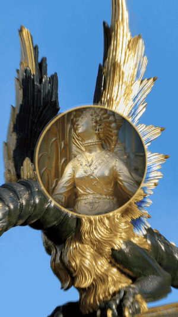

# 画中洞天 · 22.5 s · vertical (longtake case)

Preview: the hook, the stop and the drop, the pull-back, the reveal. Contact sheet every 1.5 s with the safe-zone
lines: `contact-sheet.jpg`.

**Concept.** One take down through 16 pictures taken from the author's own short films (a gilded dragon, Meissen and
willow-pattern plates, a Dresden clock, the Zhaozhou bridge, a pagoda, an old photo of the Bataclan in Paris, a satellite map,
Zhao Mengfu's *Autumn Colours on the Qiao and Hua Mountains*). Every picture has a hole in something it already has;
the hole becomes the next picture's frame. At the bottom, the camera pulls all the way back out: the whole tunnel was
the preview inside one Claude Code input.

**Clock.** A 20 s music clip, 140 BPM (beat 0.427 s), a 0.35 s silence at 6.75 s and the drop at 7.13 s.

| t (s) | beat | picture | music |
| :-- | :-- | :-- | :-- |
| 0–2.0 | 0, 2, 3, 4 | dragon → gilded figure → pagoda; three words land | intro |
| 2.0–6.75 | every 2 beats | plate → plate → clock: hold, the hole opens on a beat, dive | build |
| 6.75–7.13 | — | dead still in front of the clock's face | silence |
| 7.13–11.4 | each beat, accelerating | nine levels; a zoom counter to ×2,000,000+ | drop |
| 11.4–13.1 | — | the scroll painting pans; the one long rest | — |
| 13.1–14.8 | — | pull back through every level in one move | — |
| 14.8–17.4 | — | the input preview; the prompt types | — |
| 17.4–19.1 | half beats | enter: the preview flies into a 3×3 wall, eight tiles pop | — |
| 19.1–22.5 | — | lockup, then holds still | tail |

**Numbers (verify with `--ref` the onetake launch film).**

| | this film | reference | the rejected first cut |
| :-- | --: | --: | --: |
| still share | 0.111 | 0.103 | 0.495 |
| longest quiet (s) | 2.58 | 1.92 | 3.83 |
| peak px/frame | 440 | 530 | 390 |

The oracle counts 99 "cuts" in this film; there are none — fast zoom frames differ enough to read as cuts.

**What was rejected first.** A dot carrying a process diagram through five equal stations, no music: carry 1.00,
VERDICT PASS, and 「很死板」. The rewrite changed the subject (finished pictures instead of labels), the clock (a
track instead of reading time) and the structure (an arc instead of a list). Method: `references/vertical.md`.

The film's source is not included (it loads the author's photo set).
